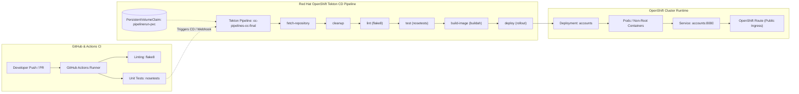

# OpenShift & Tekton CI/CD Pipeline Final Project

[](https://github.com/rushiketh07/ci-cd-final-project/actions/workflows/workflow.yml)
[](https://www.redhat.com/en/technologies/cloud-computing/openshift)
[](https://tekton.dev/)
[](https://www.python.org/)
[](LICENSE)

An enterprise-grade, cloud-native Continuous Integration and Continuous Delivery (CI/CD) pipeline built on **Red Hat OpenShift**, **Tekton Pipelines**, and **GitHub Actions**. This project demonstrates automated linting, unit testing with coverage verification, container image builds, PersistentVolumeClaim storage management, and deployment orchestration for a containerized microservice REST API.

---

## 🏗️ Architecture Overview

The end-to-end cloud-native CI/CD architecture integrates GitHub for version control and developer pull requests, GitHub Actions for rapid linting and unit testing, and Red Hat OpenShift Tekton Pipelines for container builds, workspace volume storage, and deployment rollouts.



### Microservice Components
- **Framework:** Python Flask REST API microservice (`service/routes.py`, `service/models.py`).
- **Production Server:** Gunicorn WSGI running on port `8080` under a dedicated non-root security context (`USER 1001`).
- **Persistence Layer:** PostgreSQL / CockroachDB compatible SQLAlchemy ORM.
- **Health Probes:** `/health` endpoint returning `200 OK` for Kubernetes liveness and readiness probes.

---

## 🚀 CI/CD Pipeline Workflow

### 1. Continuous Integration (GitHub Actions)
Located at [`.github/workflows/workflow.yml`](.github/workflows/workflow.yml):
- **Triggers:** Automatically runs on every `push` and `pull_request` to `main`.
- **Environment:** Ubuntu Linux runner configured with Python 3.9.
- **Linting:** Static code analysis using `flake8` validating complexity (`<=10`) and PEP 8 guidelines.
- **Testing:** Automated test execution using `nosetests` with code coverage reports (`--with-coverage --cover-package=service`).

### 2. Continuous Delivery (OpenShift & Tekton)
Located at [`.tekton/tasks.yml`](.tekton/tasks.yml) and [`.tekton/pipeline.yml`](.tekton/pipeline.yml):
- **Pipeline Name:** `oc-pipelines-oc-final`
- **Shared Storage:** `pipelinerun-pvc` PersistentVolumeClaim (Status: `Bound`, Access Mode: `ReadWriteOnce`).
- **Execution DAG:**
  1. `fetch-repository`: Clones the source Git repository into `pipeline-workspace`.
  2. `cleanup`: Empties build directories and cleans workspace between pipeline runs.
  3. `lint`: Executes containerized `flake8` linter checks.
  4. `test`: Executes containerized `nosetests` unit test suite.
  5. `build-image`: Builds the container image using Buildah and pushes to OpenShift internal registry.
  6. `deploy`: Executes rolling deployment and verifies rollout status in the namespace.

---

## 🛠️ Setup & Execution Instructions

### Prerequisites
- Python 3.9+ & `pip`
- OpenShift CLI (`oc`) configured to your target cluster
- Tekton CLI (`tkn`)
- Git

### Local Environment Setup
```bash
# Clone the repository
git clone https://github.com/rushiketh07/ci-cd-final-project.git
cd ci-cd-final-project

# Create and activate virtual environment
python -m venv .venv
source .venv/bin/activate  # On Windows: .venv\Scripts\activate

# Install dependencies
pip install --upgrade pip
pip install -r requirements.txt

# Run linting locally
flake8 . --count --max-complexity=10 --max-line-length=127 --statistics

# Run unit tests locally with coverage
nosetests -v --with-spec --spec-color --with-coverage --cover-package=service
```

### OpenShift Tekton Pipeline Deployment

1. **Log in to OpenShift Cluster:**
   ```bash
   oc login --token=<YOUR-OPENSHIFT-TOKEN> --server=<YOUR-CLUSTER-API-URL>
   oc project sn-labs-rushiketh07
   ```

2. **Provision Persistent Storage (PVC):**
   ```yaml
   apiVersion: v1
   kind: PersistentVolumeClaim
   metadata:
     name: pipelinerun-pvc
   spec:
     accessModes:
       - ReadWriteOnce
     resources:
       requests:
         storage: 1Gi
   ```
   Apply the PVC:
   ```bash
   oc apply -f pvc.yaml
   ```

3. **Install Tekton Tasks & Pipeline:**
   ```bash
   oc apply -f .tekton/tasks.yml
   oc apply -f .tekton/pipeline.yml
   ```

4. **Trigger PipelineRun:**
   ```bash
   tkn pipeline start oc-pipelines-oc-final \
     --param git-url="https://github.com/rushiketh07/ci-cd-final-project.git" \
     --param git-revision="main" \
     --param image-name="image-registry.openshift-image-registry.svc:5000/sn-labs-rushiketh07/accounts:latest" \
     --workspace name=pipeline-workspace,claimName=pipelinerun-pvc \
     --showlog
   ```

5. **Verify Running Application:**
   ```bash
   # Check pod status
   oc get pods -l app=accounts

   # View application runtime logs
   oc logs deployment/accounts -n sn-labs-rushiketh07

   # Verify health endpoint
   curl -i http://$(oc get route accounts -o jsonpath='{.spec.host}')/health
   ```

---

## 📊 Evaluation Deliverables Reference

| Task | Component | Deliverable Description |
| :--- | :--- | :--- |
| **Task 1** | Project Documentation | Public GitHub Repository `README.md` with status badge & architecture |
| **Task 2** | CI Automation | `.github/workflows/workflow.yml` with triggers, flake8 linting, & nosetests |
| **Task 3** | Tekton Tasks | `.tekton/tasks.yml` containing `cleanup`, `flake8`, and `nosetests` definitions |
| **Task 4** | Storage Configuration | Visual evidence specification for `oc-pipelines-console-pvc-details.png` (`Bound` PVC) |
| **Task 5** | CI Execution Logs | Raw terminal text output of GitHub Actions passing with exit code `0` |
| **Task 6** | Pipeline Specification | Visual evidence specification for `oc-pipelines-oc-final` pipeline graph DAG |
| **Task 7** | Successful PipelineRun | Visual evidence specification for `oc-pipelines-oc-green.png` with all tasks passed |
| **Task 8** | Application Logs | Raw container startup logs from OpenShift deployment (`oc logs deployment/accounts`) |

---

## 📄 License
This project is licensed under the Apache License 2.0 - see the [LICENSE](LICENSE) file for details.

